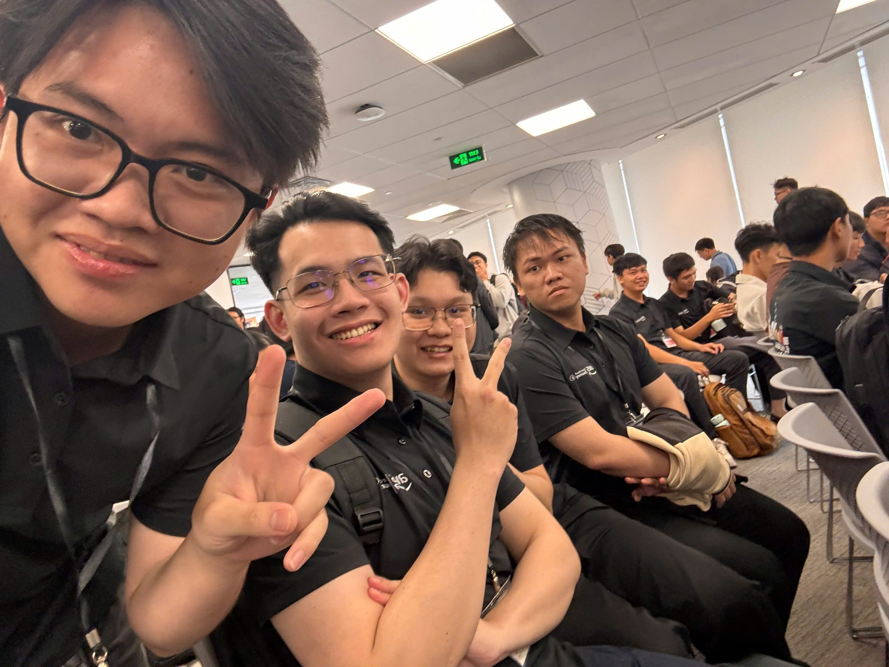
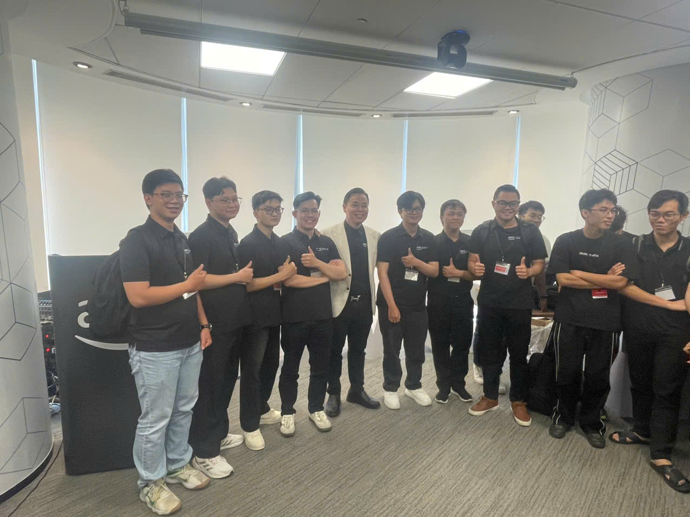

# Event Takeaways: "Buildrathon Kickoff: Code the Future with CMC Global"

### Event Objectives

- Learn more about **AWS Cloud** and real-world applications of **Generative AI**.
- Catch up on the **Agentic AI** trend and how AI Agents can be applied to solve practical problems.
- Join a **hands-on** activity building an AI Agent solution under the guidance of experts.
- Network and connect with experts from **CMC Global** and people who share the same Cloud & AI orientation.
- Gain additional perspectives on career development in **Cloud, AI and information technology**.

### Speakers

- **Thien Lu** – Program Manager, FCAJ
- **Truong Bui** – Tech Lead, CMC Global
- **Phong Pham** – Program Manager, FCAJ

### Key Highlights

#### AWS Cloud and Generative AI

- Explored the role of **AWS Cloud** in building and deploying modern applications.
- Updated on how **Generative AI** is being applied to real-world problems.
- Gained additional perspectives on combining Cloud and AI in product development.

#### Agentic AI and AI Agents

- Learned the concepts of **Agentic AI** and **AI Agents**.
- Gained a better understanding of the trend of using AI Agents in modern systems and products.
- Observed how businesses can apply AI to help solve practical problems.

#### Hands-on: building an AI Agent solution

- Joined a hands-on activity related to building an **AI Agent** solution.
- Had the opportunity to turn theoretical AI knowledge into a practical problem.
- Discussed with experts during the hands-on session to better understand how to approach and develop an AI solution.

#### Networking and career orientation

- Networked with experts from **CMC Global** and the **First Cloud Journey AI** program.
- Exchanged ideas with people who share the same orientation toward AWS, Cloud and AI.
- Gained additional perspectives on the skills and knowledge needed to grow in the technology field.

### What I Learned

#### Cloud and Generative AI go together

- An AI feature only becomes a product once it runs reliably on cloud infrastructure; the model is just one piece.
- Generative AI is moving quickly from demos to real business use, so practical deployment skills matter as much as model knowledge.

#### From chatbots to agents

- **Agentic AI** shifts the focus from producing text to completing tasks: an agent plans, calls tools and works toward a goal.
- This gave me a clearer frame for the "Ask TINA" assistant our team was planning: it should be able to act on meeting context, not only answer questions.

#### Learning by building

- The hands-on part showed that the hard work is defining the problem well before picking any technology.
- Teamwork, communication and the ability to explain a solution count as much as technical skill when building something in a short time.

### Applying to Work

- Look deeper into AI agent patterns and how tools can be connected safely to an LLM in our project.
- Combine what I know about **RAG and LLMs** with agent workflows to handle multi-step tasks.
- Practise deploying AI services on **AWS**, not only running them locally.
- Keep a product mindset: start from the user's problem, then choose models and services.

### Event Experience

**Buildrathon Kickoff: Code the Future with CMC Global** was one of my first community events in the program. It mixed talks with a practical challenge, which made Cloud and Agentic AI feel much more concrete than reading about them.

#### Speakers and practice

- The speakers explained how companies are adopting Generative AI and AI agents, and which skills they look for in engineers.
- The hands-on activity made me think through an agent-based solution end to end, from the problem to the cloud services behind it.

#### Meeting people

- I talked with engineers from **CMC Global**, FCAJ members and other students interested in Cloud & AI.
- These conversations gave me ideas on real projects and career paths that I would not get from labs alone.

#### Key takeaways

- Learning Cloud and AI works best when it is tied to building something real.
- AI agents are a direction worth following closely.
- Problem framing and teamwork are as important as technical knowledge.

#### Some event photos

*Group photo at the Buildrathon Kickoff event (1st person from the left).*

*Group photo at the Buildrathon Kickoff event (6th person from the left).*

> In short, the kickoff connected Cloud, Generative AI and AI agents to real products and pushed me to learn by building and by talking with the community.
