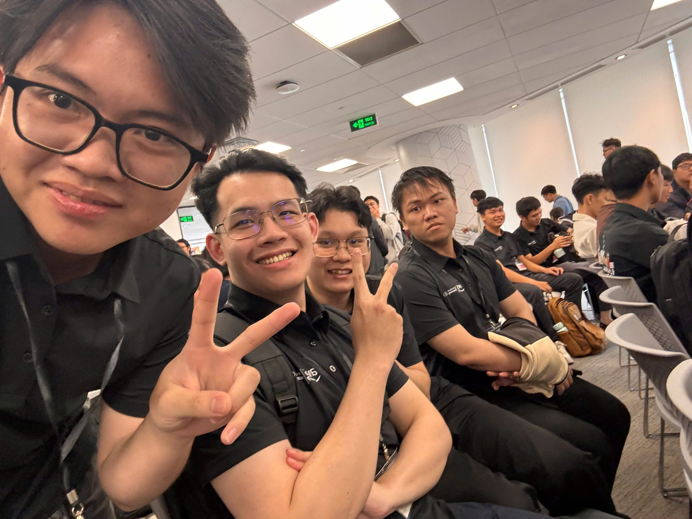
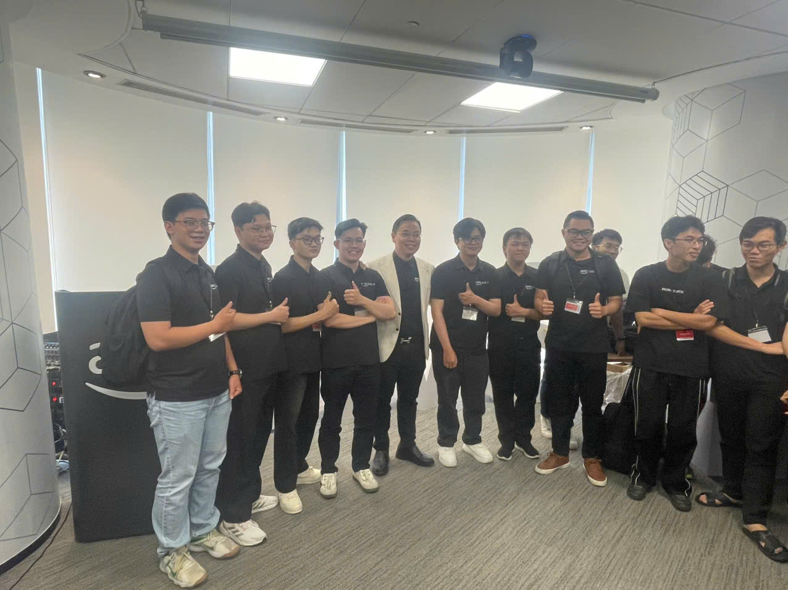

---
title: "Event 1"
date: 2026-09-26
weight: 1
chapter: false
pre: " <b> 4.1. </b> "
---

# Bài thu hoạch sự kiện “Buildrathon Kickoff: Code the Future with CMC Global”

### Mục Đích Của Sự Kiện

- Tìm hiểu thêm về **AWS Cloud** và những ứng dụng thực tế của **Generative AI**.
- Cập nhật xu hướng **Agentic AI** và cách AI Agent có thể được ứng dụng để giải quyết các bài toán thực tế.
- Tham gia hoạt động **hands-on** xây dựng giải pháp AI Agent dưới sự hướng dẫn của các chuyên gia.
- Giao lưu, kết nối với các chuyên gia đến từ **CMC Global** và những người có cùng định hướng về Cloud & AI.
- Có thêm góc nhìn về lộ trình phát triển nghề nghiệp trong lĩnh vực **Cloud, AI và công nghệ thông tin**.

### Danh Sách Diễn Giả

- **Thien Lu** – Program Manager, FCAJ
- **Truong Bui** – Tech Lead, CMC Global
- **Phong Pham** – Program Manager, FCAJ

### Nội Dung Nổi Bật

#### AWS Cloud và Generative AI

- Tìm hiểu vai trò của **AWS Cloud** trong việc xây dựng và triển khai các ứng dụng hiện đại.
- Cập nhật cách **Generative AI** đang được ứng dụng vào các bài toán thực tế.
- Có thêm góc nhìn về sự kết hợp giữa Cloud và AI trong quá trình phát triển sản phẩm.

#### Agentic AI và AI Agent

- Tìm hiểu khái niệm **Agentic AI** và **AI Agent**.
- Hiểu thêm về xu hướng sử dụng AI Agent trong các hệ thống và sản phẩm hiện đại.
- Quan sát cách doanh nghiệp có thể ứng dụng AI để hỗ trợ giải quyết các bài toán thực tế.

#### Hands-on xây dựng giải pháp AI Agent

- Tham gia hoạt động thực hành liên quan đến việc xây dựng giải pháp **AI Agent**.
- Có cơ hội chuyển những kiến thức lý thuyết về AI thành một bài toán thực tế.
- Trao đổi với chuyên gia trong quá trình thực hành để hiểu rõ hơn cách tiếp cận và phát triển một giải pháp AI.

#### Networking và định hướng nghề nghiệp

- Giao lưu với các chuyên gia đến từ **CMC Global** và chương trình **First Cloud Journey AI**.
- Trao đổi với những người có cùng định hướng về AWS, Cloud và AI.
- Có thêm góc nhìn về kỹ năng và kiến thức cần chuẩn bị để phát triển trong lĩnh vực công nghệ.

### Những Gì Học Được

#### Cloud và Generative AI luôn đi cùng nhau

- Một tính năng AI chỉ thành sản phẩm khi chạy ổn định trên hạ tầng cloud; mô hình chỉ là một phần.
- Generative AI đang chuyển rất nhanh từ demo sang ứng dụng thực tế, nên kỹ năng triển khai quan trọng không kém hiểu biết về mô hình.

#### Từ chatbot đến agent

- **Agentic AI** chuyển trọng tâm từ tạo nội dung sang hoàn thành công việc: agent tự lên kế hoạch, gọi công cụ và hướng tới mục tiêu.
- Điều này giúp tôi hình dung rõ hơn trợ lý "Ask TINA" mà nhóm đang dự định: nó cần hành động được dựa trên ngữ cảnh cuộc họp, không chỉ trả lời câu hỏi.

#### Học qua việc xây dựng

- Phần thực hành cho thấy việc khó nhất là xác định đúng bài toán trước khi chọn công nghệ.
- Làm việc nhóm, giao tiếp và khả năng trình bày giải pháp quan trọng không kém kỹ thuật khi phải làm ra sản phẩm trong thời gian ngắn.

### Ứng Dụng Vào Công Việc

- Tìm hiểu sâu hơn các mẫu thiết kế AI agent và cách kết nối công cụ với LLM một cách an toàn trong dự án.
- Kết hợp kiến thức **RAG, LLM** với luồng xử lý của agent để giải quyết các tác vụ nhiều bước.
- Thực hành triển khai dịch vụ AI trên **AWS** thay vì chỉ chạy ở máy cá nhân.
- Giữ tư duy sản phẩm: bắt đầu từ vấn đề của người dùng rồi mới chọn mô hình và dịch vụ.

### Trải nghiệm trong event

**Buildrathon Kickoff: Code the Future with CMC Global** là một trong những sự kiện cộng đồng đầu tiên của tôi trong chương trình. Sự kiện kết hợp phần chia sẻ với thử thách thực hành, giúp Cloud và Agentic AI trở nên cụ thể hơn nhiều so với chỉ đọc tài liệu.

#### Diễn giả và thực hành

- Các diễn giả chia sẻ cách doanh nghiệp đang ứng dụng Generative AI và AI agent, cũng như những kỹ năng họ cần ở kỹ sư.
- Phần hands-on buộc tôi suy nghĩ một giải pháp dựa trên agent từ đầu đến cuối, từ bài toán đến các dịch vụ cloud phía sau.

#### Gặp gỡ và trao đổi

- Tôi được trò chuyện với kỹ sư **CMC Global**, các thành viên FCAJ và nhiều bạn sinh viên cùng quan tâm Cloud & AI.
- Những cuộc trao đổi này cho tôi thêm ý tưởng về dự án thực tế và định hướng nghề nghiệp mà các bài lab không mang lại.

#### Điều rút ra

- Học Cloud và AI hiệu quả nhất khi gắn với việc làm ra sản phẩm thật.
- AI agent là hướng đáng theo dõi sát.
- Xác định bài toán và làm việc nhóm quan trọng ngang với kiến thức kỹ thuật.

#### Một số hình ảnh sự kiện

*Ảnh chụp tại sự kiện Buildrathon Kickoff (người đầu tiên từ trái qua).*

*Ảnh chụp tại sự kiện Buildrathon Kickoff (người thứ 6 từ trái qua).*

> Tóm lại, buổi kickoff giúp tôi gắn Cloud, Generative AI và AI agent với sản phẩm thực tế, đồng thời thúc đẩy tôi học qua việc xây dựng và trao đổi với cộng đồng.
