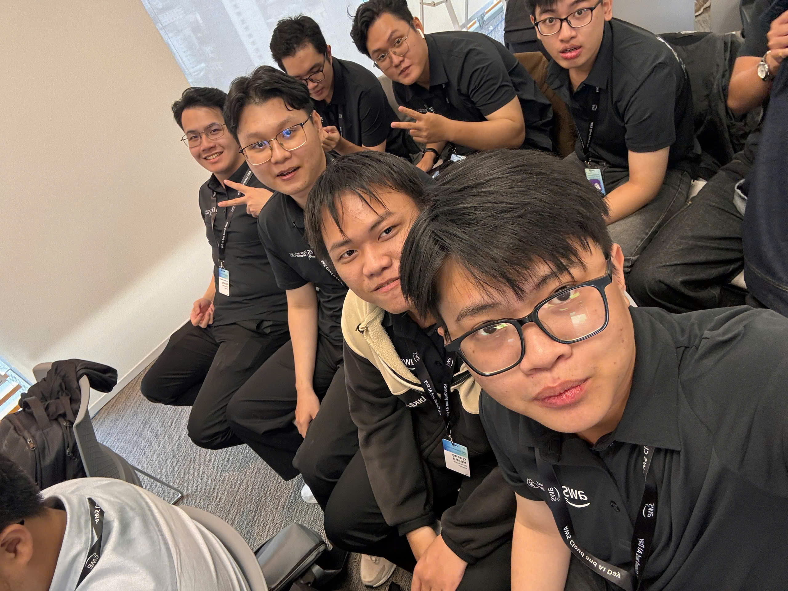
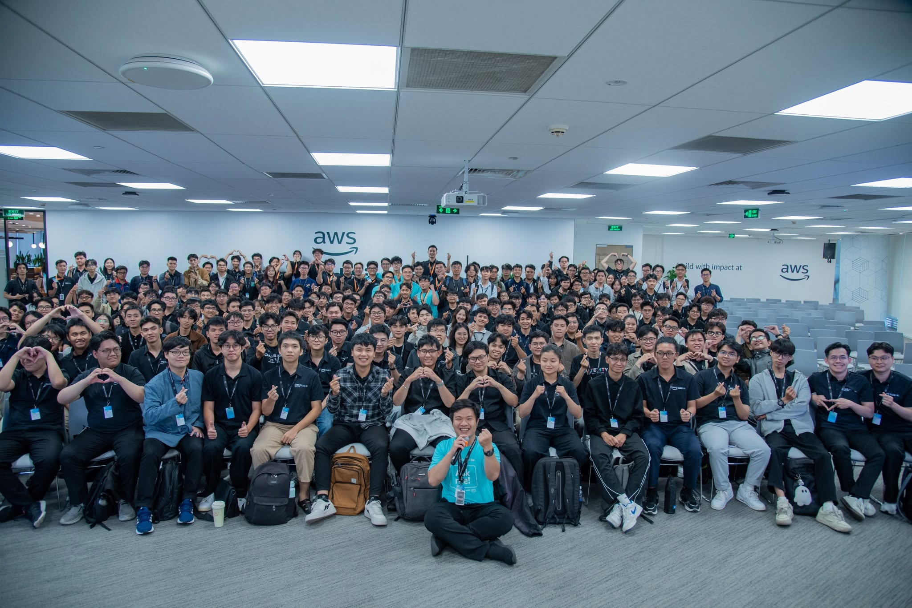

# Event Takeaways: "AWS Cloud & AI Day 2026: HCMC Watch Party"

### Event Objectives

- Catch up on emerging trends in **Cloud Computing, Artificial Intelligence and Agentic AI**.
- Learn how AWS and enterprises apply **AI Agents** to system development, modernization and operations.
- Catch up on practical content from the **Builders x AI** track, focused on AI-driven software development.
- Understand the role of AI across **Software Development Lifecycle (SDLC)** stages such as coding, security, deployment and troubleshooting.
- Study frameworks, platforms and technologies supporting AI Agent development such as **LangGraph, Strands, Amazon Bedrock AgentCore and MCP Server**.
- Gain additional perspectives on **Data Foundation, Cloud Modernization and AWS Local Zone** when building modern systems.
- Network, exchange ideas and connect with the AWS Builders community, developers, solution architects and Cloud & AI enthusiasts in HCMC.

### Speakers

The event brought together representatives from the Government, AWS, tech enterprises, partners and the builders community. Notable speakers and representatives included:

- **Mr. Pham Duc Long** – Deputy Minister of Science and Technology.
- **Ms. Jennifer Wicks** – U.S. Ambassador to Vietnam.
- **Dr. Werner Vogels** – Chief Technology Officer (CTO), Amazon.com.
- **Mr. Eric Yeo** – General Director of AWS Vietnam.
- **Dr. Jens Lottner** – Chief Executive Officer (CEO), Techcombank.
- **Ms. Mai Le** – Director of Product Management, Katalon.
- **Dung Luong Tien** – AWS Student Builder Group UTC, speaker of **"Don't use a Ferrari to Get Pho" (DEV303)**.
- **Nguyen Duc Manh** – Program Manager, AWS Student Builder Group UTC, speaker of **"Agent Harness & Agent Framework: Strands, LangGraph, Bedrock AgentCore" (DEV203)**.

The event also featured:

- **AWS Solution Architects and Senior Engineers**.
- Experts and CTOs from **Renova Cloud**.
- Technology experts from **Cloud Kinetics**.
- Representatives from **VIB, VPBank, Trusting Social and Green SM**.
- Solution consulting experts from **SoftwareOne**.

At the HCMC hub, keynotes and technical sessions of **AWS Cloud & AI Day Vietnam 2026** were followed through the **HCMC Watch Party at AWS Office HCM**, combined with discussion and networking activities with the AWS Builders community in the southern region.

### Key Highlights

#### Opening Keynote

- Updates on **Cloud and AI** development trends.
- The role of **Agentic AI Systems** in enterprise modernization and transformation.
- Additional perspectives on digital infrastructure, Data Foundation and enterprise AI strategies.
- How AWS helps enterprises build and deploy AI workloads on Cloud.

#### Building Software Like Never Before with Agentic AI

- The role of **Agentic AI** in software development.
- AI Agents can help developers perform many tasks and workflows instead of just answering single questions.
- Additional perspectives on taking AI Agents from experimentation to real-world production.
- Recognized the potential of Agentic AI in automating repetitive work in software development.

#### From Sprints to AI-Native Delivery: TCBS' Transformation of SDLC

- The journey from traditional software development to **AI-Native Delivery**.
- AI can be integrated into many different stages of the Software Development Lifecycle.
- Practical perspectives on applying AI in enterprise environments and large systems.
- The shift from **AI-assisted development** to **AI-driven development**.

#### AWS Security Agent: Proactive AppSec from Design to Deployment

- How AI is applied to **Application Security (AppSec)**.
- Security can be introduced early at the design stage instead of only being checked after completion.
- AI can help developers detect security issues from design through deployment.
- Recognized the importance of combining AI with security in application development.

#### Tackling Anti-patterns with AI-Driven Development Lifecycle (AI-DLC)

- Issues and anti-patterns that can arise when bringing AI into software development.
- The concept of **AI-Driven Development Lifecycle (AI-DLC)**.
- Using AI effectively requires clear workflows, scope and control mechanisms.
- AI should not be fully depended upon; automation must be combined with human validation.

#### Supercharging AI Coding with MCP Servers and Your Knowledge Servers

- The role of **MCP Servers** in AI Coding.
- MCP helps AI connect to tools, data and external knowledge sources.
- Knowledge Servers can provide enterprise- or project-specific context to AI.
- The importance of context when building AI Coding Assistants or AI Agents.
- More direction on using MCP to build AI systems that interact with many different tools.

#### From Symptom to Source: AI-Driven Root Cause Analysis in Minutes

- How AI can support **Root Cause Analysis**.
- AI can analyze information from multiple sources to help identify incident causes.
- Potential to reduce troubleshooting time in system operations.
- AI can participate in monitoring and operations, not just development.

#### Agent Frameworks and Agent Harness

- Technologies and frameworks supporting AI Agent development:
  - **Strands**.
  - **LangGraph**.
  - **Amazon Bedrock AgentCore**.

- The role of Agent Frameworks in:
  - Workflow orchestration.
  - State management.
  - Tool connections.
  - Organizing AI Agent reasoning and execution.

- Building AI Agents depends not only on Large Language Models but also on proper architecture and orchestration systems.

#### Data Foundation and Cloud Modernization

- The role of **Data Foundation** when deploying AI systems.
- Data must be well organized, managed and standardized to support AI applications.
- How Cloud helps enterprises modernize workloads and build scalable architectures.
- Perspectives on combining Cloud, Data and AI in digital transformation.

#### AWS Local Zones and real-world use cases

- The role of AWS Local Zones for low-latency workloads.
- Typical application groups include:
  - Banking – Finance.
  - Fintech.
  - Realtime gaming.
  - AI inference.
  * Applications that process data close to users.

- Perspectives on choosing the right infrastructure based on application latency requirements.

#### Networking and practical discussions

- Exchanging ideas on taking **AI Agents from prototype to real production environments**.
- Discussing AI Coding, Cloud and cost optimization topics.
- Further exchanges on challenges of integrating AI into current workflows.
- Connecting with the AWS Builders community, developers and tech experts in HCMC.

### What I Learned

#### What makes an agent

- A chatbot answers; an **agent** uses tools, reads knowledge sources and runs multi-step workflows.
- A production agent is a system, not just a model: LLM, agent framework, tools and external APIs, knowledge, context and memory, security, monitoring and human approval.
- Frameworks and platforms mentioned that I want to explore: **LangGraph, Strands, Amazon Bedrock AgentCore** and **MCP servers**.

#### AI across the whole SDLC

- AI now supports every stage: planning, coding, testing, security, deployment, monitoring and troubleshooting.
- The talks described a move from a traditional lifecycle to an **AI-native / AI-driven development lifecycle (AI-DLC)**. Our TINA team was already using AI-DLC, so this helped me understand why it is structured in stages with approvals.

#### MCP and context

- **Model Context Protocol (MCP)** gives AI assistants a standard way to reach tools, data and project context.
- The quality of the context largely decides the quality of AI help.

#### Security, operations and data

- Security has to be designed in from the start; AI can help find issues during development and deployment.
- AI can speed up **root cause analysis** by reading logs and metrics.
- Good AI depends on a solid data foundation and scalable cloud infrastructure; AWS Local Zones help low-latency workloads.

### Applying to Work

- Consider agent frameworks and **Bedrock AgentCore** for the meeting assistant instead of a plain Q&A model.
- Use MCP-style integrations so the agent can reach tools, APIs and knowledge bases.
- Keep a **human approval** step for actions with external effects, as TINA does before syncing tasks.
- Limit what each agent and tool can access, and plan monitoring from the design stage.
- Bring AI into testing, security review and troubleshooting, not only code generation.

### Event Experience

The **AWS Cloud & AI Day 2026: HCMC Watch Party** at the AWS office let us follow the Vietnam keynote and technical tracks together. The main threads were **Agentic AI, AI-native software development and AI-DLC**.

#### Sessions

- The sessions went beyond AI coding into security, the development lifecycle and operations.
- The parts on Strands, LangGraph, AgentCore and MCP made modern agent architecture much clearer to me: the model is only one component next to tools, context and orchestration.

#### Networking

- During the breaks I talked with members of the AWS Builders community about AI agents, AI coding and the problems of running AI in production.

#### Key takeaways

- An AI agent combines model, tools, knowledge, workflow and infrastructure.
- Automation needs clear scope, control and observability.
- AI is becoming part of every stage of software delivery.
- Production AI is a balance of automation, accuracy, security, cost, reliability and control.

### Some event photos

*Group photo at the event (I'm the photographer).*

*Group photo at the event.*

> Overall, the watch party gave me a practical picture of how AI agents, MCP and AI-DLC fit into real software delivery, and many ideas I could bring back to TINA.
