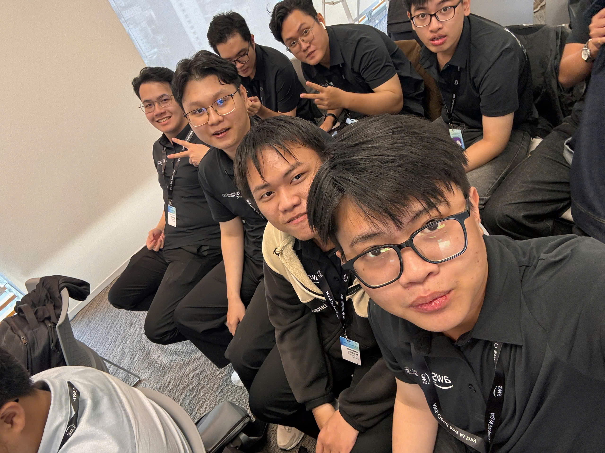
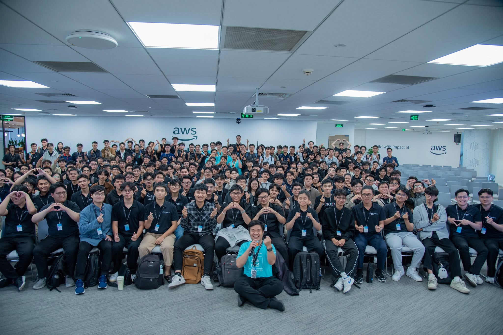

# Bài thu hoạch “AWS Cloud & AI Day 2026: HCMC Watch Party”

### Mục Đích Của Sự Kiện

- Cập nhật các xu hướng mới về **Cloud Computing, Artificial Intelligence và Agentic AI**.
- Tìm hiểu cách AWS và các doanh nghiệp ứng dụng **AI Agent** vào quá trình phát triển, hiện đại hóa và vận hành hệ thống.
- Cập nhật các nội dung thực tế từ track **Builders x AI**, tập trung vào AI-driven software development.
- Tìm hiểu vai trò của AI trong các giai đoạn của **Software Development Lifecycle (SDLC)** như coding, security, deployment và troubleshooting.
- Tìm hiểu các framework, nền tảng và công nghệ hỗ trợ xây dựng AI Agent như **LangGraph, Strands, Amazon Bedrock AgentCore và MCP Server**.
- Có thêm góc nhìn về **Data Foundation, Cloud Modernization và AWS Local Zone** trong quá trình xây dựng các hệ thống hiện đại.
- Giao lưu, trao đổi và kết nối với cộng đồng AWS Builders, developers, solution architects và những người quan tâm đến Cloud & AI tại TP.HCM.

### Danh Sách Diễn Giả

Sự kiện quy tụ các đại diện từ Chính phủ, AWS, doanh nghiệp công nghệ, đối tác và cộng đồng builders. Một số diễn giả và đại diện tiêu biểu gồm:

- **Ông Phạm Đức Long** – Thứ trưởng Bộ Khoa học và Công nghệ.
- **Bà Jennifer Wicks** – Đại sứ Hoa Kỳ tại Việt Nam.
- **Dr. Werner Vogels** – Chief Technology Officer (CTO), Amazon.com.
- **Ông Eric Yeo** – Tổng Giám đốc AWS Việt Nam.
- **Dr. Jens Lottner** – Tổng Giám đốc (CEO), Techcombank.
- **Bà Mai Lê** – Director of Product Management, Katalon.
- **Dung Luong Tien** – AWS Student Builder Group UTC, diễn giả phiên **“Don't use a Ferrari to Get Phở” (DEV303)**.
- **Nguyen Duc Manh** – Program Manager, AWS Student Builder Group UTC, diễn giả phiên **“Agent Harness & Agent Framework: Strands, LangGraph, Bedrock AgentCore” (DEV203)**.

Ngoài ra, sự kiện còn có sự tham gia của:

- Đội ngũ **AWS Solution Architects và Senior Engineers**.
- Các chuyên gia và CTO từ **Renova Cloud**.
- Chuyên gia công nghệ từ **Cloud Kinetics**.
- Đại diện từ **VIB, VPBank, Trusting Social và Green SM**.
- Chuyên gia tư vấn giải pháp từ **SoftwareOne**.

Tại điểm cầu TP.HCM, các nội dung keynote và technical sessions của **AWS Cloud & AI Day Vietnam 2026** được theo dõi thông qua **HCMC Watch Party tại AWS Office HCM**, kết hợp với các hoạt động thảo luận và networking với cộng đồng AWS Builders tại khu vực phía Nam.

### Nội Dung Nổi Bật

#### Opening Keynote

- Cập nhật xu hướng phát triển của **Cloud và AI**.
- Tìm hiểu vai trò của **Agentic AI Systems** trong quá trình hiện đại hóa và chuyển đổi doanh nghiệp.
- Có thêm góc nhìn về hạ tầng số, Data Foundation và chiến lược ứng dụng AI trong doanh nghiệp.
- Tìm hiểu cách AWS hỗ trợ doanh nghiệp xây dựng và triển khai các workload AI trên nền tảng Cloud.

#### Building Software Like Never Before with Agentic AI

- Tìm hiểu vai trò của **Agentic AI** trong phát triển phần mềm.
- AI Agent có thể hỗ trợ developer thực hiện nhiều tác vụ và workflow thay vì chỉ phản hồi câu hỏi đơn lẻ.
- Có thêm góc nhìn về việc đưa AI Agent từ giai đoạn thử nghiệm sang môi trường ứng dụng thực tế.
- Nhận thấy tiềm năng của Agentic AI trong việc hỗ trợ tự động hóa các công việc lặp lại trong quá trình phát triển phần mềm.

#### From Sprints to AI-Native Delivery: TCBS' Transformation of SDLC

- Tìm hiểu quá trình chuyển đổi từ quy trình phát triển phần mềm truyền thống sang **AI-Native Delivery**.
- AI có thể được tích hợp vào nhiều giai đoạn khác nhau của Software Development Lifecycle.
- Có thêm góc nhìn thực tế về việc ứng dụng AI trong môi trường doanh nghiệp và các hệ thống lớn.
- Hiểu thêm xu hướng chuyển từ **AI-assisted development** sang **AI-driven development**.

#### AWS Security Agent: Proactive AppSec from Design to Deployment

- Tìm hiểu cách AI được ứng dụng vào **Application Security (AppSec)**.
- Security có thể được đưa vào sớm từ giai đoạn thiết kế thay vì chỉ kiểm tra sau khi hệ thống đã hoàn thiện.
- AI có thể hỗ trợ developer phát hiện các vấn đề bảo mật xuyên suốt từ design đến deployment.
- Nhận thấy tầm quan trọng của việc kết hợp AI với security trong quá trình phát triển ứng dụng.

#### Tackling Anti-patterns with AI-Driven Development Lifecycle (AI-DLC)

- Tìm hiểu các vấn đề và anti-pattern có thể xuất hiện khi đưa AI vào quá trình phát triển phần mềm.
- Hiểu thêm khái niệm **AI-Driven Development Lifecycle (AI-DLC)**.
- Việc sử dụng AI hiệu quả cần có workflow, scope và cơ chế kiểm soát rõ ràng.
- Không nên phụ thuộc hoàn toàn vào AI mà cần kết hợp giữa automation và human validation.

#### Supercharging AI Coding with MCP Servers and Your Knowledge Servers

- Tìm hiểu vai trò của **MCP Server** trong AI Coding.
- MCP giúp AI kết nối với tools, dữ liệu và các nguồn knowledge bên ngoài.
- Các Knowledge Server có thể cung cấp context riêng của doanh nghiệp hoặc project cho AI.
- Hiểu thêm tầm quan trọng của context khi xây dựng AI Coding Assistant hoặc AI Agent.
- Có thêm định hướng sử dụng MCP để xây dựng các hệ thống AI có khả năng tương tác với nhiều công cụ khác nhau.

#### From Symptom to Source: AI-Driven Root Cause Analysis in Minutes

- Tìm hiểu cách AI có thể hỗ trợ **Root Cause Analysis**.
- AI có thể phân tích thông tin từ nhiều nguồn để hỗ trợ xác định nguyên nhân của sự cố.
- Có tiềm năng giảm thời gian troubleshooting trong quá trình vận hành hệ thống.
- AI không chỉ hỗ trợ development mà còn có thể tham gia vào monitoring và operations.

#### Agent Framework và Agent Harness

- Tìm hiểu các công nghệ và framework hỗ trợ xây dựng AI Agent:
  - **Strands**.
  - **LangGraph**.
  - **Amazon Bedrock AgentCore**.

- Hiểu thêm vai trò của Agent Framework trong việc:
  - Điều phối workflow.
  - Quản lý trạng thái.
  - Kết nối tools.
  - Tổ chức quá trình reasoning và execution của AI Agent.

- Nhận thấy rằng việc xây dựng AI Agent không chỉ phụ thuộc vào Large Language Model mà còn cần kiến trúc và hệ thống orchestration phù hợp.

#### Data Foundation và Cloud Modernization

- Tìm hiểu vai trò của **Data Foundation** khi triển khai các hệ thống AI.
- Dữ liệu cần được tổ chức, quản lý và chuẩn hóa tốt để hỗ trợ các ứng dụng AI.
- Hiểu thêm cách Cloud hỗ trợ doanh nghiệp hiện đại hóa workload và xây dựng kiến trúc có khả năng mở rộng.
- Có thêm góc nhìn về việc kết hợp Cloud, Data và AI trong quá trình chuyển đổi số.

#### AWS Local Zone và các use case thực tế

- Tìm hiểu vai trò của AWS Local Zone đối với các workload yêu cầu độ trễ thấp.
- Một số nhóm ứng dụng tiêu biểu gồm:
  - Tài chính – Ngân hàng.
  - Fintech.
  - Game realtime.
  - AI inference.
  * Các ứng dụng cần xử lý dữ liệu gần người dùng.

- Có thêm góc nhìn về cách lựa chọn hạ tầng phù hợp dựa trên yêu cầu latency của ứng dụng.

#### Networking và thảo luận thực tế

- Tham gia trao đổi về cách đưa **AI Agent từ prototype vào môi trường vận hành thực tế**.
- Thảo luận các vấn đề liên quan đến AI Coding, Cloud và tối ưu chi phí.
- Trao đổi thêm về những thách thức khi tích hợp AI vào workflow hiện tại.
- Kết nối với cộng đồng AWS Builders, developers và các chuyên gia công nghệ tại TP.HCM.

### Những Gì Học Được

#### Thế nào là một agent

- Chatbot chỉ trả lời; **agent** dùng công cụ, đọc nguồn tri thức và thực hiện quy trình nhiều bước.
- Một agent chạy thật là cả một hệ thống chứ không chỉ là mô hình: LLM, agent framework, công cụ và API bên ngoài, tri thức, ngữ cảnh và bộ nhớ, bảo mật, giám sát và bước duyệt của con người.
- Các framework và nền tảng được nhắc đến mà tôi muốn tìm hiểu: **LangGraph, Strands, Amazon Bedrock AgentCore** và **MCP server**.

#### AI trong toàn bộ vòng đời phát triển phần mềm

- AI hiện hỗ trợ mọi giai đoạn: lập kế hoạch, viết code, kiểm thử, bảo mật, triển khai, giám sát và xử lý sự cố.
- Các phiên chia sẻ mô tả sự chuyển dịch từ quy trình truyền thống sang **AI-native / AI-driven development lifecycle (AI-DLC)**. Nhóm TINA đang dùng AI-DLC, nên phần này giúp tôi hiểu vì sao quy trình được chia thành từng giai đoạn có bước duyệt.

#### MCP và ngữ cảnh

- **Model Context Protocol (MCP)** cho trợ lý AI một cách chuẩn để kết nối công cụ, dữ liệu và ngữ cảnh dự án.
- Chất lượng ngữ cảnh quyết định phần lớn chất lượng hỗ trợ của AI.

#### Bảo mật, vận hành và dữ liệu

- Bảo mật phải được tính từ khâu thiết kế; AI có thể giúp phát hiện vấn đề trong lúc phát triển và triển khai.
- AI giúp **phân tích nguyên nhân gốc** nhanh hơn nhờ đọc log và metric.
- AI tốt cần nền tảng dữ liệu vững và hạ tầng cloud có khả năng mở rộng; AWS Local Zones hỗ trợ các workload cần độ trễ thấp.

### Ứng Dụng Vào Công Việc

- Cân nhắc dùng agent framework và **Bedrock AgentCore** cho trợ lý cuộc họp thay vì chỉ một mô hình hỏi đáp.
- Dùng cách tích hợp kiểu MCP để agent truy cập công cụ, API và knowledge base.
- Giữ bước **duyệt của con người** cho các hành động tác động ra bên ngoài, như cách TINA làm trước khi đồng bộ task.
- Giới hạn quyền truy cập của từng agent và công cụ, lên kế hoạch giám sát ngay từ lúc thiết kế.
- Đưa AI vào kiểm thử, review bảo mật và xử lý sự cố, không chỉ sinh code.

### Trải nghiệm trong event

Buổi **AWS Cloud & AI Day 2026: HCMC Watch Party** tại văn phòng AWS cho chúng tôi cùng theo dõi phần keynote và các phiên kỹ thuật của sự kiện tại Việt Nam. Các chủ đề chính là **Agentic AI, phát triển phần mềm AI-native và AI-DLC**.

#### Các phiên chia sẻ

- Nội dung không dừng ở AI coding mà mở rộng sang bảo mật, vòng đời phát triển và vận hành.
- Phần về Strands, LangGraph, AgentCore và MCP giúp tôi hiểu rõ kiến trúc agent hiện đại: mô hình chỉ là một thành phần bên cạnh công cụ, ngữ cảnh và điều phối.

#### Giao lưu

- Trong giờ nghỉ, tôi trao đổi với cộng đồng AWS Builders về AI agent, AI coding và những khó khăn khi đưa AI vào vận hành thật.

#### Điều rút ra

- AI agent là sự kết hợp của mô hình, công cụ, tri thức, quy trình và hạ tầng.
- Tự động hóa cần phạm vi rõ ràng, cơ chế kiểm soát và khả năng quan sát.
- AI đang trở thành một phần của mọi giai đoạn phát triển phần mềm.
- Đưa AI vào production là cân bằng giữa tự động hóa, độ chính xác, bảo mật, chi phí, độ tin cậy và khả năng kiểm soát.

### Một số hình ảnh khi tham gia sự kiện

*Ảnh chụp tại sự kiện (tôi là người chụp ảnh).*

*Ảnh chụp tập thể tại sự kiện.*

> Nhìn chung, buổi watch party cho tôi bức tranh thực tế về cách AI agent, MCP và AI-DLC đi vào quy trình phát triển phần mềm, cùng nhiều ý tưởng có thể áp dụng cho TINA.
