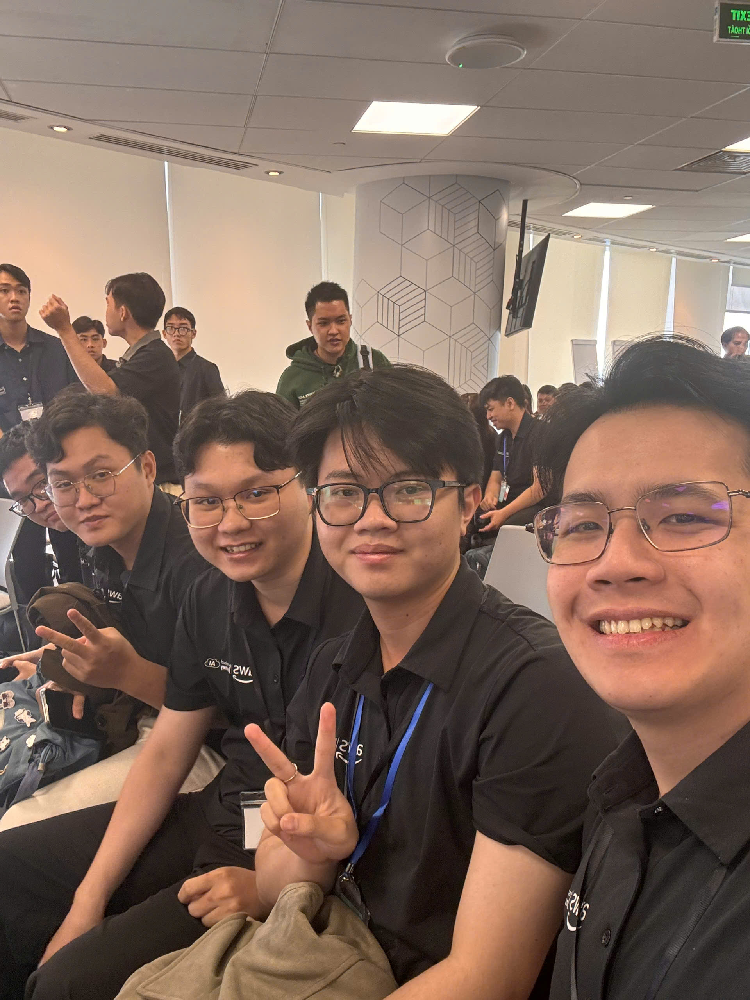

# Event Takeaways: "AWS First Cloud AI Journey Community Day"

### Event Objectives

- Learn how engineering teams approach software development at scale, including the practical challenges of building Software Factories.
- Explore the skills students need to bridge academic learning and real-world Cloud and software engineering work.
- Understand the ideas presented in the AWS Lambda Web Functions session, particularly HTTP handling, request concurrency, performance and cost considerations.
- Explore how Amazon Simple Queue Service (Amazon SQS) can decouple components and support asynchronous system design.
- Learn from an AWS internship journey and explore ways to begin and maintain contributions to open-source projects.
- Connect the technical topics to future Cloud projects and professional development.

### Speakers

The event poster introduced six speakers from industry and the FCAJ community:

- Thinh Nguyen – STYL Solutions.
- Henry Duc Bui – CloudThinker.
- Hung Tran – NAB.
- Dao Cu Long – FCAJ.
- Khang Duong – FCAJ.
- Tuan Tran – FCAJ.

The event was scheduled for 9:00 AM–12:00 PM on Saturday, October 31, 2026, at the 26th floor of Bitexco Financial Tower, 2 Hai Trieu Street, Ho Chi Minh City.

### Key Highlights

#### Lessons Learned from Building Software Factories (9:00–9:25 AM)

- The session focused on practical lessons from building Software Factories at scale rather than treating software delivery as a series of isolated coding tasks.
- Its agenda highlighted common implementation pitfalls and the importance of identifying approaches that work in real engineering teams.
- A useful topic for further study is how standardized workflows, automation and feedback loops support predictable software delivery.
- The session provides a reason to examine maintainability and developer experience alongside deployment speed.

#### Education (9:30–9:55 AM)

- This session examined how students can prepare for Cloud and software engineering careers from an educator's perspective.
- It addressed the gap between university learning and expectations in the workplace.
- Technical fundamentals, hands-on projects, communication and independent problem-solving are all relevant areas for students to reflect on.
- The discussion topic emphasizes that completing tutorials is different from explaining design decisions and working within a team.

#### AWS Lambda Web Functions: Rethinking Serverless Web Architecture (10:00–10:25 AM)

- The session introduced an approach to Serverless web applications involving native HTTP support and multi-concurrency of up to 128 requests, as described in the event agenda.
- It raised the question of when a Serverless approach can reduce adapter overhead compared with alternative deployment patterns.
- Active CPU Billing was included as a topic for analyzing cost efficiency rather than considering only the number of invocations.
- Performance benchmarking against container-based workloads on Amazon EC2 or Amazon ECS was part of the announced session scope.
- The key architectural question is how latency, request patterns, scaling behavior and total operating costs affect platform selection.

#### Amazon SQS: Building Asynchronous Systems (10:30–11:00 AM)

- Amazon SQS was presented as a building block for asynchronous processing and decoupling services.
- Queues allow work to be buffered rather than requiring every request to be completed immediately by a downstream component.
- A practical design should account for retries, visibility timeouts, duplicate messages and dead-letter queues where appropriate.
- An example is a file-processing application: the upload service receives a file, while workers independently process queued tasks.
- The session topic illustrates how asynchronous design can improve resilience and help systems handle fluctuating workloads.

#### My 3-Month AWS Internship Journey (11:00–11:25 AM)

- This session shared a three-month internship perspective, including the use of AWS services in a real project.
- A relevant lesson is to connect technical exercises with clear project objectives and measurable outcomes.
- Cloud projects involve more than launching resources: security, monitoring, documentation, cost and troubleshooting also matter.
- The session offered a useful context for reviewing learning progress and preparing for the transition from university projects to professional work.

#### Start & Maintain Consistency with Open Source Contributing (11:30 AM–12:00 PM)

- The session focused on how to begin contributing to open-source projects and maintain a consistent contribution habit.
- Contributions can start with documentation, issue reproduction, small bug fixes or tests instead of large feature implementations.
- Reviewing contribution guidelines and working with Git branches and pull requests are practical skills to develop.
- Regular, manageable contributions can help build familiarity with collaborative software development and code review.

### What I Learned

#### Engineering process and career

- Sustainable delivery comes from clear conventions, repeatable workflows and fast feedback, not just writing code faster.
- It helps to document an internship project with its goals, architecture, decisions and results, so the work can be explained later.

#### Serverless with evidence

- Choosing Lambda, EC2 or ECS should depend on the workload: request volume, run time, concurrency and latency.
- Benchmarks are only fair under comparable conditions, and real cost includes supporting services, idle capacity and operations, not only the compute price.

#### Queues and asynchronous work

- **Amazon SQS** decouples how fast requests arrive from how fast workers process them, so producers and consumers scale on their own.
- Reliable queues need retries, idempotency, dead-letter queues and monitoring of queue depth.
- This maps directly to audio transcription and sending notifications after a meeting, both of which TINA does in the background.

#### Open source

- Small, regular contributions are a practical way to learn real codebases; reading existing code and docs is part of the work.

### Applying to Work

- Automate testing, builds and deployment wherever the workflow is still manual.
- Compare serverless and ECS options with realistic traffic, latency and cost numbers before deciding.
- Move slow tasks such as transcription jobs and follow-up emails out of the request path, using a queue with retry and dead-letter handling.
- Write down architecture, permissions, monitoring and trade-offs in the project docs.
- Start a habit of small, reviewable open-source contributions.

### Event Experience

**AWS First Cloud AI Journey Community Day** covered software engineering, cloud architecture and career growth in one morning, with talks from both industry and former interns.

#### Architecture in practice

- The Software Factories talk made me think about the processes needed to build and maintain software at scale.
- The Lambda Web Functions and SQS talks linked architecture choices to measurable performance, cost and reliability.

#### Learning and career

- The education and internship talks stressed hands-on learning and being able to justify technical choices.
- The open-source talk gave a concrete way to practise team workflows outside class.

#### Key takeaways

- Process and collaboration shape software as much as code does.
- Serverless should be judged with measurements for the actual workload.
- Queues improve scalability, but retries, monitoring and failure handling are what make them reliable.
- Consistent practice, including open source, builds long-term engineering skill.

### Some Event Photos

*AWS First Cloud AI Journey Community Day (2nd person from the right).*

> Overall, Community Day linked architecture choices such as serverless and queues with the engineering habits and career skills needed to apply them well.

