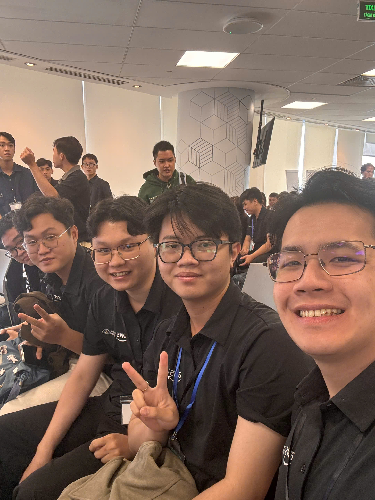

# Bản thu hoạch: "AWS First Cloud AI Journey Community Day"

### Mục tiêu sự kiện

- Hiểu cách các nhóm kỹ thuật tiếp cận phát triển phần mềm quy mô lớn, bao gồm những thách thức thực tế khi xây dựng các Software Factories.
- Khám phá các kỹ năng sinh viên cần thiết để nối kết giữa học thuật và công việc thực tế về Cloud và kỹ thuật phần mềm.
- Tìm hiểu các ý kiến trong phiên AWS Lambda Web Functions, đặc biệt về xử lý HTTP, đồng thời xử lý yêu cầu, hiệu suất và cân nhắc chi phí.
- Khám phá cách Amazon Simple Queue Service (Amazon SQS) có thể tách rời các thành phần và hỗ trợ thiết kế hệ thống bất đồng bộ.
- Học từ hành trình thực tập AWS và tìm hiểu cách bắt đầu và duy trì đóng góp vào các dự án mã nguồn mở.
- Kết nối các chủ đề kỹ thuật với các dự án Cloud trong tương lai và phát triển sự nghiệp.

### Diễn giả

Bộ 사이트 sự kiện giới thiệu sáu diễn giả từ doanh nghiệp và cộng đồng FCAJ:

- Thinh Nguyen – STYL Solutions.
- Henry Duc Bui – CloudThinker.
- Hung Tran – NAB.
- Dao Cu Long – FCAJ.
- Khang Duong – FCAJ.
- Tuan Tran – FCAJ.

Sự kiện được lên lịch từ 9:00 sáng đến 12:00 trưa ngày Thứ Bảy, 31 tháng 10 năm 2026, tại tầng 26 của Bitexco Financial Tower, 2 đường Hải Triều, Thành phố Hồ Chí Minh.

### Nội dung nổi bật

#### Bài học rút ra từ việc xây dựng các Software Factories (9:00–9:25 AM)

- Phiên tập trung vào các bài học thực tế từ việc xây dựng các Software Factories quy mô lớn thay vì coi việc phân phối phần mềm là chuỗi các nhiệm vụ lập trình tách biệt.
- Lịch trình của phiên nhấn mạnh những bẫy triển khai phổ biến và tầm quan trọng của việc xác định các phương pháp hoạt động trong các nhóm kỹ thuật thực tế.
- Một chủ đề hữu ích để nghiên cứu thêm là cách các quy trình làm việc chuẩn hóa, tự động hóa và vòng phản hồi hỗ trợ phân phối phần mềm có thể dự đoán.
- Phiên cung cấp lý do để xem xét khả năng bảo trì và trải nghiệm của nhà phát triển bên cạnh tốc độ triển khai.

#### Giáo dục (9:30–9:55 AM)

- Phiên này xem xét cách sinh viên có thể chuẩn bị cho sự nghiệp Cloud và kỹ thuật phần mềm từ góc độ của nhà giáo dục.
- Nó giải quyết khoảng cách giữa học tập đại học và kỳ vọng tại nơi làm việc.
- Cơ sở kỹ thuật, dự án thực hành, giao tiếp và giải quyết vấn đề độc lập là tất cả các lĩnh vực liên quan mà sinh viên nên suy ngẫm.
- Chủ đề thảo luận nhấn mạnh rằng hoàn thành các bài hướng dẫn khác nhau với việc giải thích quyết định thiết kế và làm việc trong nhóm.

#### AWS Lambda Web Functions: Rethinking Serverless Web Architecture (10:00–10:25 AM)

- Phiên giới thiệu một cách tiếp cận đối với các ứng dụng web Serverless liên quan đến hỗ trợ HTTP gốc và đa-tranh xử lý lên đến 128 yêu cầu, như được mô tả trong lịch trình sự kiện.
- Nó đặt ra câu hỏi về khi nào một cách tiếp cận Serverless có thể giảm chi phí chuyển đổiAdapter so với các mô hình triển khai thay thế.
- Active CPU Billing đã được đưa vào làm chủ đề phân tích hiệu quả chi phí thay vì chỉ xét số lần gọi.
- Đánh giá điểm chuẩn hiệu suất so với các khối công việc dựa trên bộ chứa trên Amazon EC2 hoặc Amazon ECS là một phần trong phạm vi phiên đã công bố.
- Câu hỏi kiến trúc chính là cách độ trễ, mô hình yêu cầu, hành vi mở rộng và chi phí vận hành tổng thể ảnh hưởng đến việc chọn nền tảng.

#### Amazon SQS: Xây dựng các hệ thống bất đồng bộ (10:30–11:00 AM)

- Amazon SQS được trình bày là một khối xây dựng cho xử lý bất đồng bộ và tách rời các dịch vụ.
- Hàng đợi cho phép công việc được đệm thay vì yêu cầu mỗi yêu cầu phải được hoàn thành ngay lập tức bởi thành phần phía dưới.
- Thiết kế thực tế cần tính đến các lần thử lại, thời gian tầm nhìn, tin nhắn trùng lặp và hàng đợi thư mục thư từ khi thích hợp.
- Một ví dụ là ứng dụng xử lý tệp: dịch vụ tải lên nhận một tệp, trong khi các công nhân độc lập xử lý các tác vụ được xếp hàng.
- Chủ đề phiên minh họa cách thiết kế bất đồng bộ có thể cải thiện khả năng phục hồi và giúp hệ thống xử lý các khối lượng công việc biến động.

#### Hành trình thực tập AWS 3 tháng của tôi (11:00–11:25 AM)

- Phiên chia sẻ góc nhìn thực tập ba tháng, bao gồm việc sử dụng các dịch vụ AWS trong một dự án thực tế.
- Một bài học liên quan là kết nối các bài tập kỹ thuật với các mục tiêu dự án rõ ràng và các kết quả có thể đo lường.
- Các dự án Cloud liên quan nhiều hơn là khởi chạy tài nguyên: bảo mật, giám sát, tài liệu, chi phí và khắc phục sự cố cũng quan trọng.
- Phiên cung cấp bối cảnh hữu ích để xem xét tiến độ học tập và chuẩn bị cho sự chuyển đổi từ các dự án đại học sang công việc chuyên nghiệp.

#### Bắt đầu & Giữ tính nhất quán với đóng góp mã nguồn mở (11:30 AM–12:00 PM)

- Phiên tập trung vào cách bắt đầu đóng góp vào các dự án mã nguồn mở và duy trì một thói quen đóng góp nhất quán.
- Đóng góp có thể bắt đầu với tài liệu, sao chép vấn đề, sửa lỗi nhỏ hoặc thử nghiệm thay vì triển khai các tính năng lớn.
- Xem xét các hướng dẫn đóng góp và làm việc với nhánh Git và các pull requests là các kỹ năng thực tế để phát triển.
- Đóng góp thường xuyên, có thể quản lý được có thể giúp xây dựng sự quen thuộc với phát triển phần mềm cộng tác và đánh giá mã.

### Những gì tôi học được

#### Quy trình kỹ thuật và nghề nghiệp

- Phát triển phần mềm bền vững đến từ quy ước rõ ràng, quy trình lặp lại được và phản hồi nhanh, không chỉ là viết code nhanh hơn.
- Nên ghi lại dự án thực tập với mục tiêu, kiến trúc, các quyết định và kết quả để sau này có thể trình bày lại.

#### Serverless phải dựa trên số liệu

- Chọn Lambda, EC2 hay ECS cần dựa vào đặc điểm workload: lượng request, thời gian chạy, mức đồng thời và độ trễ.
- Benchmark chỉ công bằng khi điều kiện so sánh tương đương, và chi phí thật gồm cả dịch vụ đi kèm, tài nguyên nhàn rỗi và công vận hành chứ không chỉ giá compute.

#### Hàng đợi và xử lý bất đồng bộ

- **Amazon SQS** tách tốc độ request đến khỏi tốc độ worker xử lý, nhờ đó bên gửi và bên nhận mở rộng độc lập.
- Hàng đợi tin cậy cần retry, idempotency, dead-letter queue và theo dõi độ dài hàng đợi.
- Điều này áp dụng trực tiếp cho phiên âm audio và gửi thông báo sau cuộc họp, hai việc TINA đều chạy nền.

#### Mã nguồn mở

- Đóng góp nhỏ nhưng đều đặn là cách thực tế để làm quen codebase thật; đọc code và tài liệu có sẵn cũng là một phần công việc.

### Ứng dụng vào công việc

- Tự động hóa kiểm thử, build và triển khai ở những chỗ quy trình còn làm tay.
- So sánh phương án serverless và ECS bằng số liệu thực tế về lưu lượng, độ trễ và chi phí trước khi quyết định.
- Đưa các tác vụ chậm như phiên âm hay email follow-up ra khỏi luồng request, dùng hàng đợi có retry và dead-letter.
- Ghi rõ kiến trúc, phân quyền, giám sát và các đánh đổi trong tài liệu dự án.
- Tạo thói quen đóng góp mã nguồn mở nhỏ, dễ review.

### Trải nghiệm sự kiện

**AWS First Cloud AI Journey Community Day** gói gọn kỹ thuật phần mềm, kiến trúc cloud và phát triển nghề nghiệp trong một buổi sáng, với chia sẻ từ cả doanh nghiệp lẫn các bạn thực tập khóa trước.

#### Kiến trúc trong thực tế

- Phần Software Factories khiến tôi suy nghĩ về những quy trình cần có để xây dựng và duy trì phần mềm ở quy mô lớn.
- Phần Lambda Web Functions và SQS gắn lựa chọn kiến trúc với hiệu năng, chi phí và độ tin cậy đo được.

#### Học tập và nghề nghiệp

- Các phần về giáo dục và thực tập nhấn mạnh học qua thực hành và khả năng giải thích lựa chọn kỹ thuật.
- Phần mã nguồn mở cho tôi một cách cụ thể để luyện làm việc nhóm ngoài giờ học.

#### Điều rút ra

- Quy trình và cách phối hợp ảnh hưởng đến phần mềm không kém code.
- Serverless cần được đánh giá bằng số đo trên chính workload của mình.
- Hàng đợi giúp mở rộng, nhưng retry, giám sát và xử lý lỗi mới làm nó tin cậy.
- Luyện tập đều đặn, kể cả đóng góp mã nguồn mở, giúp phát triển kỹ năng lâu dài.

### Một số ảnh sự kiện

*AWS First Cloud AI Journey Community Day (người thứ 2 tính từ phải qua trái).*

> Nhìn chung, Community Day giúp tôi nối các lựa chọn kiến trúc như serverless và hàng đợi với thói quen làm việc và kỹ năng nghề nghiệp cần có để áp dụng chúng hiệu quả.
