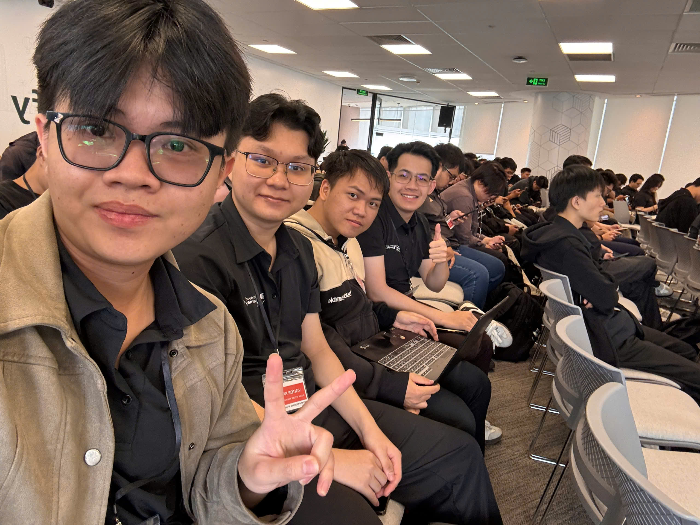

# Event Takeaways: "Cloud Mastery"

### Event Objectives

- Gain deeper insights into core Cloud computing concepts and practical AWS architectures tailored for students and aspiring Cloud engineers.
- Bridge the gap between theoretical knowledge and real-world industry requirements through direct mentorship and open Q&A sessions.
- Understand career pathways, certification roadmaps, and essential skill sets needed to pursue roles in Cloud, DevOps, and AI/ML.
- Reinforce technical knowledge through interactive group activities and a live technical quiz.
- Build connections with fellow tech students across Ho Chi Minh City and mentors from the First Cloud AI Journey (FCAJ) community.

### Event Overview & Context

The **Cloud Mastery** event was organized by the **First Cloud AI Journey (FCAJ)** community for university students across Ho Chi Minh City. 

- **Date & Time:** Saturday morning, November 14, 2026.
- **Location:** AWS Vietnam Office, 26th Floor, Bitexco Financial Tower, 2 Hai Trieu Street, District 1, Ho Chi Minh City.
- **Participants:** Young tech students from various universities in Saigon alongside experienced mentors from FCAJ.

### Key Highlights

#### Technical Sharing & Cloud Foundations

- The session covered practical perspectives on mastering Cloud technologies, emphasizing hands-on practice over passive learning.
- Mentors shared structured learning paths for students starting from foundational AWS services before advancing to complex architectures.
- Discussions highlighted the importance of understanding core infrastructure components, security best practices, and cost optimization early in a student's learning journey.

#### Extended Open Q&A Session

- One of the standout segments of the morning was an extensive, high-energy Q&A session that felt almost endless due to the strong engagement from attendees.
- Students raised practical and thought-provoking questions spanning two main areas:
  - **Career Orientation:** How to prepare portfolios, stand out in technical interviews, choose between specialized tracks (Solutions Architect, Cloud Engineer, DevOps), and transition from academic projects to internships.
  - **Technical Deep Dives:** Real-world architectural challenges, troubleshooting approaches, and best practices when building applications on AWS.
- Mentors provided candid, actionable feedback grounded in real project experience rather than textbook definitions.

#### Interactive Quiz Challenge

- The event concluded with an enthusiastic technical Quiz game designed to test participants' understanding of the morning's topics and general AWS knowledge.
- The activity created a lively, competitive atmosphere while helping students review key concepts in a memorable way.

#### Community Preview: AWS Student Community Day Vietnam 2026

- During the closing remarks, organizers shared an exciting preview of an upcoming student-focused Cloud workshop: **AWS Student Community Day Vietnam 2026**, scheduled for the following weekend.
- This announcement encouraged participants to stay active in the ecosystem and continue their learning momentum.

### What I Learned

#### Building a Cloud career

- A strong Cloud profile combines solid fundamentals, documented hands-on work and the ability to explain architecture trade-offs.
- Asking specific questions about your own situation is the quickest way to get useful advice from practitioners.
- Being active in tech communities speeds up learning because you meet people solving the same problems.

#### How to think about Cloud

- Knowing service names is not enough; what matters is how services fit together to solve scaling and business problems.
- Timed quizzes are a good way to find gaps in core knowledge.

### Applying to Work

- Follow a learning plan that mixes AWS fundamentals labs with small end-to-end projects.
- Record challenges, design decisions and debugging steps in GitHub and technical notes, as I do in my weekly worklog.
- Keep joining community workshops, study groups and Q&A sessions.
- Review compute, storage, networking and IAM basics to prepare for technical interviews.

### Event Experience

**Cloud Mastery** took place at the AWS office in Bitexco Financial Tower and felt lively and welcoming for students interested in Cloud.

#### Open Q&A and learning from peers

- The long open Q&A turned the session into a real conversation driven by students' own questions.
- Hearing questions from students at other universities showed me that many of us face the same technical and career challenges.
- The closing quiz and the introduction to AWS Student Community Day Vietnam 2026 left me motivated to keep learning with the FCAJ community.

### Some Event Photos

*Cloud Mastery event (1st person from the left).*

> Overall, Cloud Mastery was an open, friendly session that helped me sharpen my learning plan and reminded me how much I can learn from other students.
