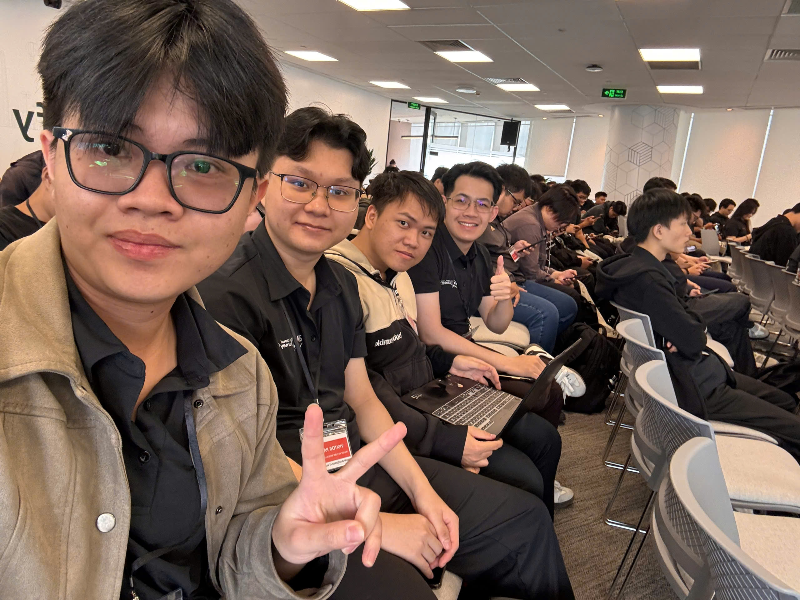

# Bản thu hoạch: "Cloud Mastery"

### Mục tiêu sự kiện

- Hiểu sâu hơn về các khái niệm cốt lõi của Cloud computing và các kiến trúc AWS thực tế, được thiết kế dành cho sinh viên và những người muốn theo đuổi sự nghiệp Cloud.
- Thu hẹp khoảng cách giữa kiến thức lý thuyết và yêu cầu thực tế của ngành thông qua các buổi cố vấn trực tiếp và phiên hỏi đáp mở.
- Tìm hiểu con đường sự nghiệp, lộ trình chứng chỉ và những kỹ năng cần thiết để theo đuổi các vị trí trong lĩnh vực Cloud, DevOps và AI/ML.
- Củng cố kiến thức kỹ thuật thông qua các hoạt động nhóm tương tác và một trò chơi đố vui kỹ thuật trực tiếp.
- Kết nối với các bạn sinh viên công nghệ khắp Thành phố Hồ Chí Minh và các mentor từ cộng đồng First Cloud AI Journey (FCAJ).

### Tổng quan và bối cảnh sự kiện

Sự kiện **Cloud Mastery** được cộng đồng **First Cloud AI Journey (FCAJ)** tổ chức dành cho sinh viên đại học trên địa bàn Thành phố Hồ Chí Minh.

- **Thời gian:** Sáng Thứ Bảy, ngày 14 tháng 11 năm 2026.
- **Địa điểm:** Văn phòng AWS Vietnam, tầng 26, Bitexco Financial Tower, 2 đường Hải Triều, Quận 1, Thành phố Hồ Chí Minh.
- **Tham dự gia:** Các bạn sinh viên công nghệ trẻ từ nhiều trường đại học tại Sài Gòn cùng với các mentor giàu kinh nghiệm từ FCAJ.

### Nội dung nổi bật

#### Chia sẻ kỹ thuật và nền tảng Cloud

- Phiên chia sẻ mang góc nhìn thực tế về cách làm chủ các công nghệ Cloud, nhấn mạnh việc thực hành trực tiếp thay vì học thụ động.
- Các mentor chia sẻ lộ trình học tập có cấu trúc cho sinh viên, bắt đầu từ các dịch vụ AWS nền tảng trước khi tiến tới các kiến trúc phức tạp.
- Cuộc thảo luận nhấn mạnh tầm quan trọng của việc hiểu các thành phần hạ tầng cốt lõi, các nguyên tắc bảo mật tốt nhất và tối ưu chi phí ngay từ giai đoạn đầu của hành trình học tập.

#### Phiên hỏi đáp mở kéo dài

- Một trong những khoảnh khắc nổi bật nhất của buổi sáng là phiên hỏi đáp dài và đầy năng lượng, tưởng như không bao giờ kết thúc vì sự tham gia nhiệt tình từ người dự.
- Sinh viên đã đặt những câu hỏi thực tế và gợi mở, xoay quanh hai chủ đề chính:
  - **Định hướng nghề nghiệp:** Làm thế nào để chuẩn bị portfolio, nổi bật trong phỏng vấn kỹ thuật, lựa chọn giữa các hướng chuyên môn (Solutions Architect, Cloud Engineer, DevOps) và chuyển tiếp từ dự án học thuật sang thực tập.
  - **Đi sâu kỹ thuật:** Các thách thức kiến trúc thực tế, cách tiếp cận khắc phục sự cố và các nguyên tắc tốt nhất khi xây dựng ứng dụng trên AWS.
- Các mentor đưa ra phản hồi thẳng thắn, dễ áp dụng dựa trên kinh nghiệm dự án thực tế thay vì những định nghĩa trong sách giáo khoa.

#### Thử thách đố vui tương tác

- Sự kiện khép lại bằng một trò chơi đố vui kỹ thuật sôi động nhằm kiểm tra mức độ hiểu biết của người tham dự về các chủ đề trong sáng và kiến thức AWS nói chung.
- Hoạt động này tạo ra không khí sôi nổi, cạnh tranh đồng thời giúp sinh viên ôn lại các khái niệm quan trọng một cách đáng nhớ.

#### Giới thiệu cộng đồng: AWS Student Community Day Vietnam 2026

- Trong phần phát biểu kết thúc, ban tổ chức đã chia sẻ một thông tin thú vị về sự kiện sắp tới dành cho sinh viên: **AWS Student Community Day Vietnam 2026**, dự kiến diễn ra vào cuối tuần ngay sau đó.
- Thông báo này khuyến khích người tham dự tiếp tục hoạt động trong hệ sinh thái và duy trì đà học tập.

### Những gì tôi học được

#### Xây dựng sự nghiệp Cloud

- Một hồ sơ Cloud tốt cần nền tảng vững, các bài thực hành có tài liệu rõ ràng và khả năng giải thích các đánh đổi kiến trúc.
- Đặt câu hỏi cụ thể về tình huống của chính mình là cách nhanh nhất để nhận lời khuyên hữu ích từ người đi trước.
- Tham gia cộng đồng công nghệ giúp học nhanh hơn vì được gặp những người đang giải cùng một bài toán.

#### Tư duy về Cloud

- Biết tên dịch vụ là chưa đủ; điều quan trọng là hiểu các dịch vụ kết hợp với nhau thế nào để giải quyết bài toán mở rộng và kinh doanh.
- Quiz giới hạn thời gian là cách tốt để phát hiện lỗ hổng kiến thức nền.

### Ứng dụng vào công việc

- Theo một lộ trình học kết hợp lab nền tảng AWS với các dự án nhỏ làm trọn vẹn từ đầu đến cuối.
- Ghi lại khó khăn, quyết định thiết kế và các bước gỡ lỗi trên GitHub và ghi chú kỹ thuật, như cách tôi viết worklog hằng tuần.
- Tiếp tục tham gia workshop cộng đồng, nhóm học và các buổi hỏi đáp.
- Ôn lại kiến thức cơ bản về compute, storage, networking và IAM để chuẩn bị phỏng vấn kỹ thuật.

### Trải nghiệm sự kiện

**Cloud Mastery** diễn ra tại văn phòng AWS ở Bitexco Financial Tower, không khí sôi nổi và thân thiện với các bạn sinh viên yêu thích Cloud.

#### Hỏi đáp mở và học từ bạn bè

- Phần hỏi đáp kéo dài biến buổi gặp thành một cuộc trò chuyện thật sự, xoay quanh chính câu hỏi của sinh viên.
- Nghe câu hỏi của các bạn trường khác cho tôi thấy nhiều người cùng gặp những khó khăn giống nhau về kỹ thuật và định hướng nghề nghiệp.
- Phần quiz cuối buổi và giới thiệu AWS Student Community Day Vietnam 2026 khiến tôi có thêm động lực tiếp tục học cùng cộng đồng FCAJ.

### Một số ảnh sự kiện

*Cloud Mastery (người đầu tiên từ trái sang phải).*

> Nhìn chung, Cloud Mastery là một buổi gặp cởi mở, thân thiện, giúp tôi điều chỉnh lộ trình học và nhận ra mình học được rất nhiều từ các bạn sinh viên khác.
