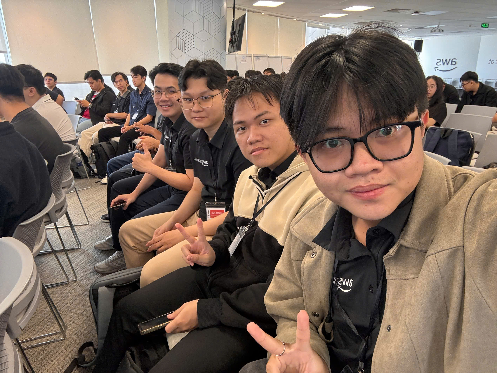

# Event Takeaways: "AWS Student Community Day Vietnam 2026"

### Event Objectives

- Gain practical, hands-on insights into Cloud Computing and Artificial Intelligence directly from experienced industry speakers.
- Explore emerging trends and real-world applications in the Cloud and AI era tailored for university students.
- Connect and network with student builders, community leaders, and tech practitioners across Ho Chi Minh City.
- Reinforce technical understanding and engage with the community through interactive Q&A sessions and live minigames.
- Fulfill community engagement milestones as part of the First Cloud AI Journey (FCAJ) OJT learning path.

### Event Overview & Co-Organizers

**AWS Student Community Day Vietnam 2026** is a flagship student-led tech conference co-organized by the alliance of **AWS Student Builder Groups (SBG)** across four major universities in Ho Chi Minh City:

- **HUFLIT** – AWS Student Builder Group at HUFLIT
- **HCMUTE** – AWS Student Builder Group HCMUTE
- **PTIT** – AWS Student Builder Group PTIT HCM
- **SGU** – AWS Student Builder Group Saigon University

**Event Logistics:**
- **Date & Time:** 9:00 AM – 11:30 AM, Saturday, November 21, 2026.
- **Venue:** 26th Floor, Bitexco Financial Tower, 02 Hai Trieu Street, Saigon Ward, Ho Chi Minh City, Vietnam.

### Key Highlights

#### Student-Led Cloud & AI Ecosystem

- Designed *by students for students*, the conference highlighted the rapid growth of university-level Cloud communities in Vietnam.
- Representatives from the four Student Builder Groups collaborated to deliver a structured program bridging campus learning with real-world AWS ecosystems.

#### Practical Cloud & AI Technical Sessions

- Industry speakers shared hands-on perspectives on deploying modern workloads using AWS Cloud and AI services.
- Sessions emphasized practical implementation, architectural thinking, and how students can leverage Cloud and AI tools to accelerate their personal projects and career readiness.

#### Interactive Q&A and Minigames

- Participants actively engaged with speakers during open Q&A segments, raising questions about technical implementation, skill building, and career progression in Cloud and AI.
- Live minigames and interactive challenges kept the energy high and rewarded attendees with exclusive AWS swags and community gifts.

### What I Learned

#### Cloud and AI skills together

- Entry-level engineering roles increasingly expect both Cloud architecture basics and the ability to work with AI.
- Building, testing and iterating on real services teaches far more than reading alone.

#### Student communities

- Cross-university groups such as the AWS Student Builder Groups offer peer support, shared resources and chances to lead.
- Talking directly with speakers and organizers helps students understand industry expectations and start a professional network early.

### Applying to Work

- Use Cloud and AI services discussed at the event in my own projects, starting with the TINA deployment on AWS.
- Write up architecture lessons and implementation notes to strengthen my portfolio.
- Stay involved with student builder groups and the FCAJ community.

### Event Experience

**AWS Student Community Day Vietnam 2026** gathered many young builders at the AWS Vietnam office. It was organized by students from HUFLIT, HCMUTE, PTIT and SGU, and the atmosphere was energetic and welcoming.

#### Campus meets industry

- The event showed how student-led initiatives can connect students directly with Cloud practitioners.
- Technical talks, open Q&A and minigames together made it both informative and motivating to keep building on AWS.

### Some Event Photos

*AWS Student Community Day Vietnam 2026 (1st person from the right).*

> Overall, Student Community Day was an energetic, student-led event that strengthened my motivation to keep building with Cloud and AI and to stay active in the community.
