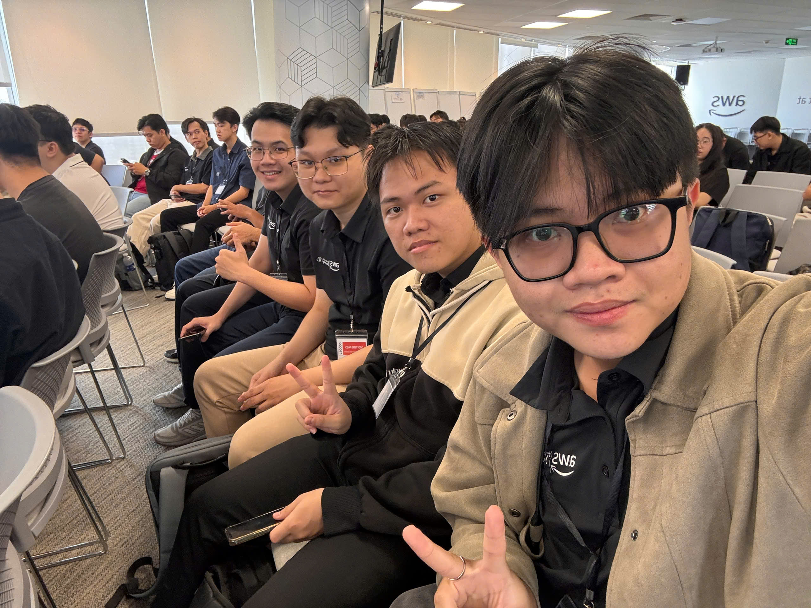

# Bản thu hoạch: "AWS Student Community Day Vietnam 2026"

### Mục tiêu sự kiện

- Tiếp cận kiến thức thực tế về Cloud Computing và Trí tuệ nhân thông qua các diễn giả giàu kinh nghiệm trong ngành.
- Khám phá các xu hướng mới nổi và ứng dụng thực tế trong kỷ nguyên Cloud và AI, dành riêng cho sinh viên đại học.
- Kết nối và giao lưu với các bạn sinh viên xây dựng công nghệ, lãnh đạo cộng đồng và những người làm công nghệ tại Thành phố Hồ Chí Minh.
- Củng cố hiểu biết kỹ thuật và gắn kết cộng đồng thông qua các phiên hỏi đáp tương tác và những trò chơi nhỏ trực tiếp.
- Hoàn thành các mốc tham gia cộng đồng trong lộ trình học tập OJT của First Cloud AI Journey (FCAJ).

### Tổng quan và các đơn vị đồng tổ chức

**AWS Student Community Day Vietnam 2026** là hội nghị công nghệ tiêu biểu do sinh viên dẫn dắt, được đồng tổ chức bởi liên minh các **AWS Student Builder Group (SBG)** tại bốn trường đại học lớn ở Thành phố Hồ Chí Minh:

- **HUFLIT** – AWS Student Builder Group tại HUFLIT
- **HCMUTE** – AWS Student Builder Group HCMUTE
- **PTIT** – AWS Student Builder Group PTIT HCM
- **SGU** – AWS Student Builder Group Saigon University

**Thông tin sự kiện:**
- **Thời gian:** 9:00 – 11:30 sáng, Thứ Bảy, ngày 21 tháng 11 năm 2026.
- **Địa điểm:** Tầng 26, Bitexco Financial Tower, số 02 đường Hải Triều, phường Sài Gòn, Thành phố Hồ Chí Minh, Việt Nam.

### Nội dung nổi bật

#### Hệ sinh thái Cloud & AI do sinh viên dẫn dắt

- Với thiết kế *do sinh viên vì sinh viên*, hội nghị làm nổi bật sự phát triển nhanh chóng của các cộng đồng Cloud cấp đại học tại Việt Nam.
- Đại diện từ bốn Student Builder Group đã cùng hợp tác xây dựng một chương trình có cấu trúc, kết nối việc học trên giảng đường với hệ sinh thái AWS thực tế.

#### Các phiên kỹ thuật thực tế về Cloud & AI

- Các diễn giả từ doanh nghiệp chia sẻ góc nhìn thực hành về triển khai các khối công việc hiện đại bằng dịch vụ AWS Cloud và AI.
- Các phiên nhấn mạnh việc triển khai thực tế, tư duy kiến trúc và cách sinh viên có thể tận dụng công cụ Cloud và AI để thúc đẩy dự án cá nhân và sự sẵn sàng nghề nghiệp.

#### Hỏi đáp tương tác và minigame

- Người tham dự tích cực trao đổi với diễn giả trong các phiên hỏi đáp mở, đặt câu hỏi về triển khai kỹ thuật, xây dựng kỹ năng và lộ trình sự nghiệp trong Cloud và AI.
- Các minigame trực tiếp và thử thách tương tác giữ không khí sôi động, đồng thời tặng người dự những quà AWS và quà cộng đồng độc quyền.

### Những gì tôi học được

#### Kết hợp kỹ năng Cloud và AI

- Các vị trí kỹ sư mới vào nghề ngày càng yêu cầu cả nền tảng kiến trúc Cloud lẫn khả năng làm việc với AI.
- Tự xây dựng, kiểm thử và cải tiến trên dịch vụ thật giúp học được nhiều hơn hẳn so với chỉ đọc lý thuyết.

#### Cộng đồng sinh viên

- Các nhóm liên trường như AWS Student Builder Groups mang lại sự hỗ trợ từ bạn bè, tài liệu chung và cơ hội dẫn dắt.
- Trao đổi trực tiếp với diễn giả và ban tổ chức giúp sinh viên hiểu kỳ vọng của ngành và xây dựng mạng lưới quan hệ từ sớm.

### Ứng dụng vào công việc

- Áp dụng các dịch vụ Cloud và AI được nhắc đến trong sự kiện vào dự án của mình, bắt đầu từ việc triển khai TINA trên AWS.
- Ghi lại bài học kiến trúc và ghi chú triển khai để làm hồ sơ năng lực tốt hơn.
- Tiếp tục tham gia các nhóm builder sinh viên và cộng đồng FCAJ.

### Trải nghiệm sự kiện

**AWS Student Community Day Vietnam 2026** quy tụ rất nhiều bạn trẻ yêu công nghệ tại văn phòng AWS Việt Nam. Sự kiện do sinh viên HUFLIT, HCMUTE, PTIT và SGU cùng tổ chức, không khí sôi nổi và gần gũi.

#### Giảng đường gặp doanh nghiệp

- Sự kiện cho thấy các hoạt động do sinh viên dẫn dắt có thể kết nối trực tiếp sinh viên với người làm Cloud thực tế.
- Các bài nói kỹ thuật, phần hỏi đáp mở và minigame giúp buổi gặp vừa bổ ích vừa tạo động lực tiếp tục xây dựng trên AWS.

### Một số ảnh sự kiện

*AWS Student Community Day Vietnam 2026 (người đầu tiên từ phải sang trái).*

> Nhìn chung, Student Community Day là một sự kiện sôi nổi do sinh viên tổ chức, tiếp thêm động lực để tôi tiếp tục xây dựng với Cloud, AI và tích cực tham gia cộng đồng.
